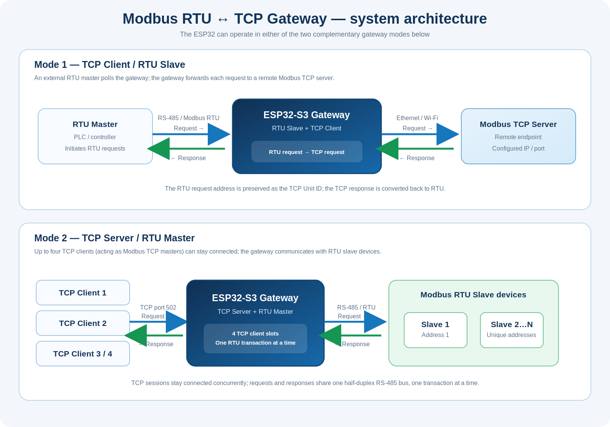
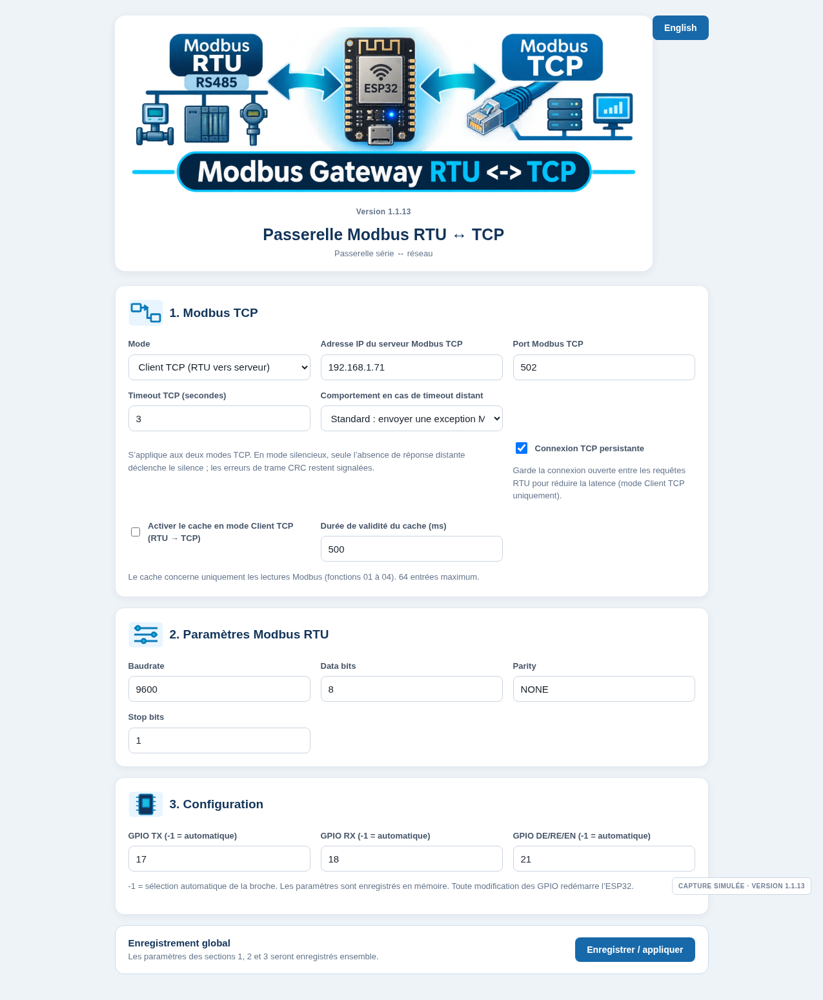
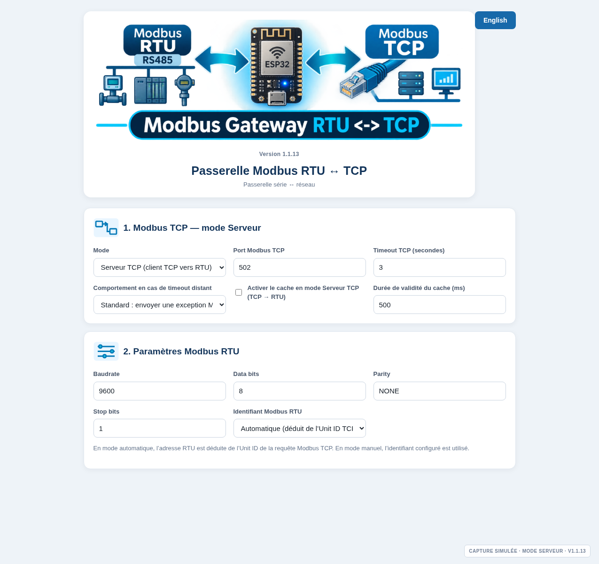
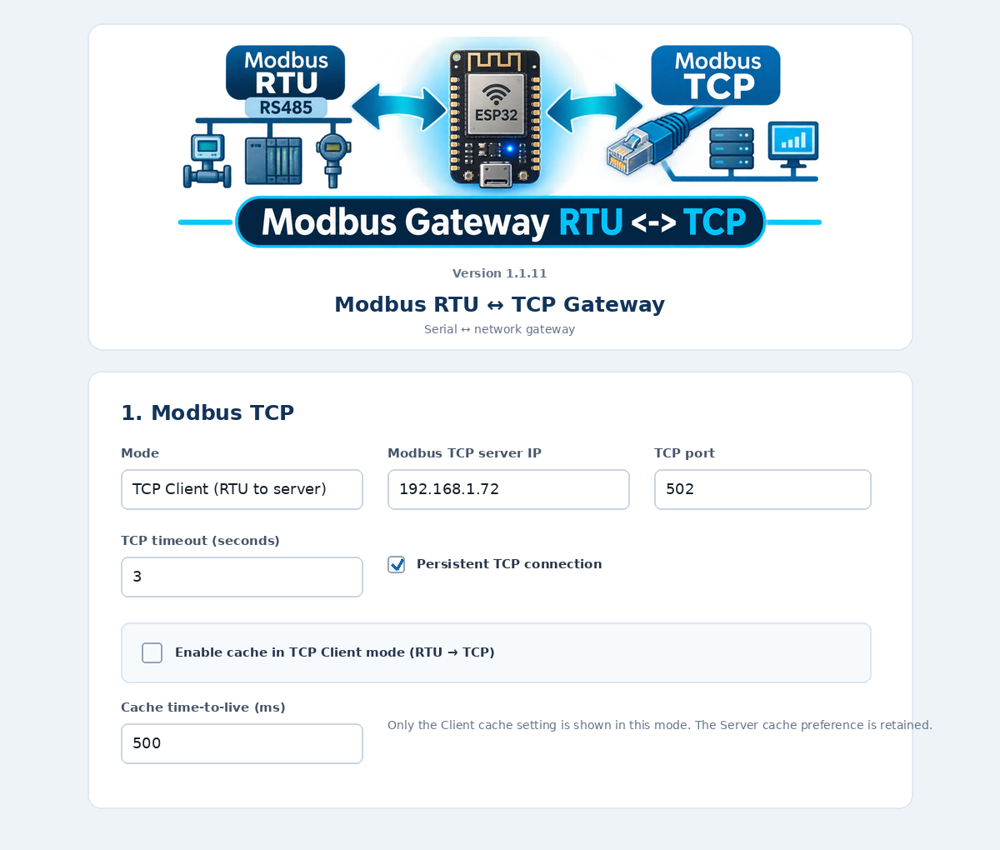
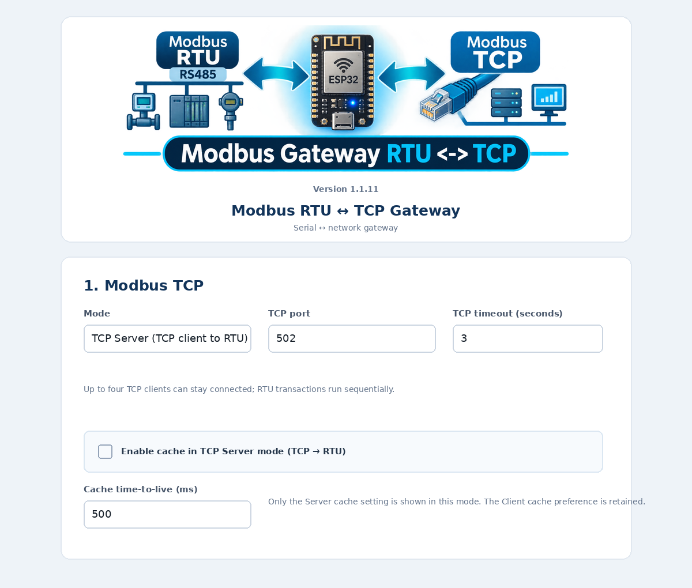
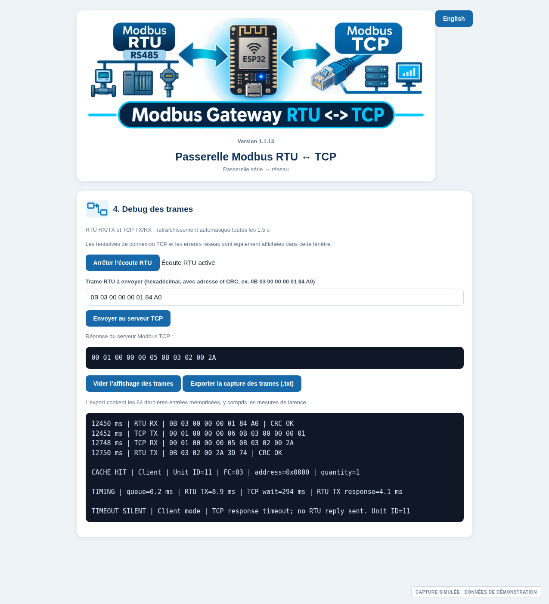
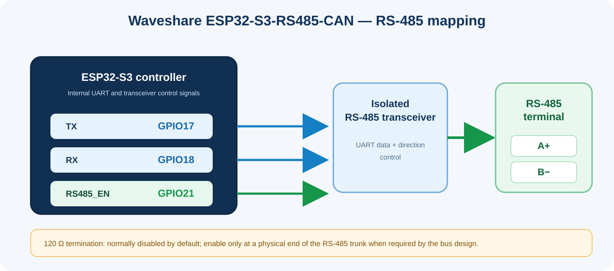

<p align="center">
  
</p>

# Modbus RTU ↔ TCP Gateway for ESPHome

[](LICENSE)

A Wi-Fi Modbus gateway built with **ESPHome**, **ESP32-S3** and the **Arduino framework**. It bridges a serial Modbus RTU / RS-485 bus and a Modbus TCP network, with a bilingual web interface for configuration and frame diagnostics.

> **Reference hardware:** [Waveshare ESP32-S3-RS485-CAN](https://docs.waveshare.com/ESP32-S3-RS485-CAN). The project defaults match this board's RS-485 signals: TX GPIO17, RX GPIO18 and RS485 enable GPIO21. The project maintainer reports successful testing with this device, including four connected Modbus TCP clients.

## Response cache

The gateway provides two independent optional response caches, one for each operating mode:

- **TCP Client mode (RTU → TCP):** repeated RTU read requests can be answered from the last valid Modbus TCP response.
- **TCP Server mode (TCP → RTU):** repeated TCP read requests can be answered from the last valid RTU response without querying the RS-485 bus again.

Both caches are disabled by default. Each can be enabled separately in the Web UI. A shared time-to-live (TTL) can be configured from 50 to 10,000 ms (default 500 ms). The cache has 64 entries and only stores valid read functions 01–04. Write and read/write operations are never cached; successful writes invalidate only overlapping cached ranges in the corresponding writable data space. Unknown or malformed write ranges trigger a conservative invalidation of all cached reads for that Unit ID and direction. Cache hits do not extend the TTL. Cached values may therefore be stale by up to the configured TTL; keep the cache disabled when every read must return the freshest device value.

See [Cache behavior and configuration](docs/CACHE.md) for details. The cache option displayed in Section 1 follows the selected TCP mode; the other mode's setting remains saved in NVS.

## Features

- Per-transaction latency diagnostics in both TCP Client and TCP Server modes.
- Non-blocking TCP response reception in normal TCP Client mode: the ESPHome loop keeps servicing the Web UI and other tasks while the remote Modbus TCP server prepares its response.

- **Two operating modes**
  - **TCP Client / RTU Slave:** an external RTU master polls the ESP32; the gateway forwards each request to a configured remote Modbus TCP server.
  - **TCP Server / RTU Master:** Modbus TCP masters connect to the ESP32; the gateway forwards their requests to downstream RTU slave devices.
- **Up to four concurrent TCP master connections** in TCP Server mode.
- **Single-transaction RS-485 scheduling:** the half-duplex RTU bus is accessed one transaction at a time; ready requests from connected clients are serviced with a rotating starting slot.
- TCP Transaction ID and the incoming TCP Unit ID are preserved in the response.
- **RTU address / Unit ID handling** is explicit and configurable (see [Protocol behaviour](docs/PROTOCOL.md)).
- Web interface in **French and English**.
- Settings are saved persistently in ESP32 NVS (Arduino `Preferences`). GPIO changes trigger an automatic restart so the UART can be reinitialized.
- Frame diagnostics: live RTU/TCP frame log, RTU CRC status, manual RTU-frame test and text export of the latest 64 log entries, including timing diagnostics.
- **RTU CRC protection:** invalid RTU requests/responses are rejected before forwarding or caching; CRC failures are recorded in the diagnostics log. TCP Server mode returns gateway exception `0x0B` for an invalid downstream RTU response.
- **Selectable remote-timeout policy:** one bilingual Web UI setting applies to both modes. `Standard` (default) returns a Modbus gateway exception when the remote endpoint times out; `Silent` sends no response upstream for that timeout only. The setting survives restart.
- **Mode-aware cache controls:** Section 1 shows only the cache switch for the selected TCP mode. The inactive mode's enable setting is preserved when saving or switching modes.
- Images are served on separate HTTP routes instead of being embedded in the HTML response, keeping the page response small.
- **Persistent TCP Client connection** is enabled by default to avoid a new TCP handshake for every RTU request; disable it in Section 1 when a remote server requires one connection per request. The gateway reconnects when it detects a dropped session.
- **Web UI reboot button** displays a five-second countdown and returns to the main page as soon as the gateway is online again.
- TCP diagnostics report the actual IP address from ESPHome's Wi-Fi component, rather than relying only on the Arduino `WiFi.localIP()` accessor.

## System architecture



## Screenshots

### Configuration page



### TCP Server mode and RTU Unit ID

The RTU address selector is shown in TCP Server mode. This illustration shows the automatic mapping from the incoming TCP Unit ID to the RTU slave address.



### Mode-specific response cache controls

In TCP Client mode, only the Client cache switch is shown:



In TCP Server mode, only the Server cache switch is shown:



The inactive mode's setting remains saved when the configuration is applied.

### Frame diagnostics



*These are rendered documentation previews built from the project's current page layout and image assets. Values and example frames are illustrative, not a live capture from a connected device.*

## Hardware

The reference board is the **Waveshare ESP32-S3-RS485-CAN**. It provides an isolated RS-485 transceiver, an A+/B− screw terminal, Wi-Fi and USB-C. The board also has a separate CAN interface; CAN is not used by this gateway.

| Gateway signal | ESP32-S3 GPIO | Waveshare signal |
|---|---:|---|
| UART TX | 17 | RS-485 TXD1 |
| UART RX | 18 | RS-485 RXD1 |
| RS-485 direction enable | 21 | RS485_EN |

The mapping is shown in the [Waveshare board schematic](https://files.waveshare.com/wiki/ESP32-S3-RS485-CAN/ESP32-S3-RS485-CAN-Schematic.pdf) and the corresponding defaults are set in `components/modbus_gateway/__init__.py` and the web UI. The web UI allows these GPIO values to be changed for other ESP32-S3 hardware.



Connect the external RS-485 trunk to the board's **A+** and **B−** terminals. The on-board 120 Ω termination is disabled by default; enable it only when this device is at a physical end of the RS-485 line and the bus design calls for termination. See [Hardware and wiring](docs/HARDWARE_WAVESHARE.md) before powering or wiring the device.

## Quick start

1. Install ESPHome on your development computer or use the ESPHome Dashboard.
2. Copy this repository to your ESPHome configuration area.
3. Create a local `secrets.yaml` next to `my-modbus-gateway.yaml` (do not commit it). It must define `wifi_ssid`, `wifi_password` and `api_key`; see [`secrets.yaml.example`](secrets.yaml.example).
4. Review `my-modbus-gateway.yaml`. It targets `esp32-s3-devkitc1-n16r8` and uses the Arduino framework. Adjust the board target only if your exact module variant requires it.
5. Compile and upload:

   ```bash
   esphome compile my-modbus-gateway.yaml
   esphome upload my-modbus-gateway.yaml
   ```

6. Find the ESP32's IP address in your router or ESPHome logs and open `http://<ESP32-IP>/` in a browser on the same network.
7. Configure the TCP mode, network endpoint and serial settings. Press **Save / apply**. The settings are persisted; changing a GPIO restarts the ESP32 automatically.

See [Quick start and configuration](docs/QUICK_START.md) for full instructions.

## Default configuration

| Setting | Initial value |
|---|---|
| Framework | Arduino |
| ESPHome board target | `esp32-s3-devkitc1-n16r8` |
| Initial mode | TCP Client |
| TCP remote host (TCP Client mode) | 192.168.1.100 |
| TCP port | 502 |
| TCP timeout | 3 seconds |
| Remote timeout behavior | Standard (send gateway exception) |
| Persistent TCP Client connection | Enabled by default (configurable in the web UI) |
| RTU serial format | 9600 baud, 8 data bits, no parity, 1 stop bit (8N1) |
| UART TX / RX | GPIO17 / GPIO18 |
| RS-485 direction enable | GPIO21 |
| Concurrent inbound TCP clients | 4 maximum |
| Web interface | HTTP port 80 |

## Operating modes at a glance

| Mode | Data direction | RTU device address behaviour |
|---|---|---|
| TCP Client | RTU → TCP | The RTU request address is forwarded unchanged as the TCP Unit ID. The manual RTU ID setting does not override it. |
| TCP Server — Automatic ID | TCP → RTU | The incoming TCP Unit ID becomes the RTU slave address. |
| TCP Server — Manual ID | TCP → RTU | The configured RTU ID (1–247) is used on RS-485; the TCP response still carries the original incoming Unit ID. |

Only TCP Server mode accepts inbound Modbus TCP masters. Up to four clients can keep their TCP sessions open at once. Their requests are not executed in parallel on RS-485: one complete RTU transaction is processed at a time.

## Documentation

- [Quick start and configuration](docs/QUICK_START.md)
- [System architecture](docs/ARCHITECTURE.md)
- [Waveshare ESP32-S3-RS485-CAN hardware and wiring](docs/HARDWARE_WAVESHARE.md)
- [Protocol behaviour, timeout policy and Unit ID mapping](docs/PROTOCOL.md)
- [Troubleshooting](docs/TROUBLESHOOTING.md)
- [Byte-level latency diagnostics](docs/LATENCY_DIAGNOSTICS.md)
- [Client TCP asynchronous handling](docs/CLIENT_TCP_ASYNC.md)
- [Response cache configuration and behavior](docs/CACHE.md)

## Security notes

- The web UI is served over plain HTTP and has no login/authentication layer in this project.
- Modbus TCP is not encrypted or authenticated by this gateway.
- Keep the ESP32 and its Modbus TCP port on a trusted LAN or isolated industrial VLAN. Do not expose ports 80 or 502 directly to the public Internet.
- Change the fallback access-point password in the YAML before deploying the device in an operational environment.
- Do not commit `secrets.yaml`, Wi-Fi credentials, API encryption keys or other credentials.

## Project status and limitations

The project maintainer reports that the current firmware works on the Waveshare ESP32-S3-RS485-CAN and that four TCP clients have been connected successfully in their test setup. The RS-485 bus remains half-duplex and is serviced sequentially. A fifth inbound TCP connection is rejected while all four slots are occupied.

The screenshots in this repository are documentation previews. Validate the firmware on the exact board, transceiver, baud rate and field bus before production use. No formal conformance certification or safety certification is claimed.

## License

This project is licensed under the **GNU General Public License v3.0 or any later
version** (`GPL-3.0-or-later`). See the [`LICENSE`](LICENSE) file for the full
license text.

Unless a file or component states otherwise, the same license applies to the
original project documentation, diagrams, screenshots, and artwork included in
this repository. Copyright in individual contributions remains with their
respective authors. Third-party software and trademarks retain their own
licenses and ownership; see [`THIRD_PARTY_NOTICES.md`](THIRD_PARTY_NOTICES.md).

The software is provided **without warranty**; see Sections 15 and 16 of the
GPLv3 license text.


## Latest release

Current component version: **1.1.13**. The bilingual Web UI includes a shared Standard/Silent remote-timeout policy for both TCP modes, mode-aware response-cache controls and write-range-aware cache invalidation. See [CHANGELOG.md](CHANGELOG.md) for the release history, [docs/CLIENT_TCP_ASYNC.md](docs/CLIENT_TCP_ASYNC.md) for cooperative Client TCP handling, and [docs/CACHE.md](docs/CACHE.md) for cache behavior and data-freshness limits.
