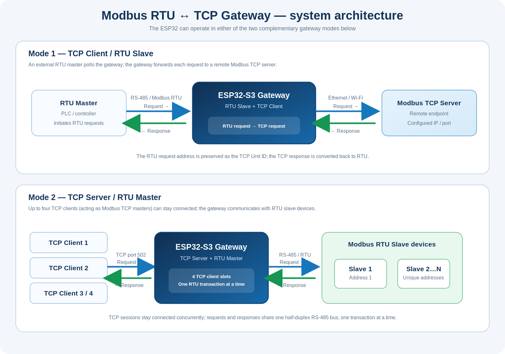

<!-- SPDX-License-Identifier: GPL-3.0-or-later -->
<!-- Copyright (C) 2026 Modbus RTU-TCP Gateway contributors. -->

# System architecture

The gateway supports two complementary operating modes. The role names below describe the role played by the **ESP32 gateway** on each network interface. Each link is bidirectional: requests travel toward the destination device, and responses return along the same path.

## Mode 1 — TCP Client / RTU Slave

In this mode, the ESP32 behaves as:

- a **Modbus RTU slave** on its RS-485 interface;
- a **Modbus TCP client** on the IP network.

An external RTU master (for example, a PLC) sends a request to the gateway's RTU address. The gateway, acting as a **TCP client**, forwards that request to the configured remote Modbus TCP server. The RTU address from the incoming request is preserved as the TCP Unit ID. The remote TCP response travels back to the gateway, is converted into an RTU response, and is returned to the original RTU master.

The TCP destination host, port and timeout are configured in the web interface. In this mode, the RTU address override controls are hidden because the incoming RTU address must be preserved.

## Mode 2 — TCP Server / RTU Master

In this mode, the ESP32 behaves as:

- a **Modbus TCP server** on the IP network (port 502 by default; configurable);
- a **Modbus RTU master** on its RS-485 interface.

One to four **Modbus TCP clients** can connect to the gateway at the same time; each client acts as a Modbus TCP master. Each complete TCP request is converted into an RTU request and sent by the gateway (the RTU master) to the downstream RTU slave device. The RTU response returns to the gateway, is converted back to Modbus TCP, and is sent to the TCP client that originated the request.

The RTU address can be selected in the web interface:

- **Automatic:** use the incoming TCP Unit ID as the RTU slave address.
- **Manual:** use the configured RTU ID (1–247), independently of the incoming TCP Unit ID. The TCP response retains the original Unit ID and Transaction ID.

## Why RTU transactions are sequential

The RS-485 link is shared and half-duplex. Multiple TCP sessions can remain connected, but they must not drive the same RTU bus simultaneously. The gateway therefore processes one RTU request/response transaction at a time. In TCP Server mode, ready requests are serviced across the connected client slots using a rotating starting slot, and each response is sent to its originating TCP connection.

## Summary

| Gateway mode | ESP32 TCP role | ESP32 RTU role | Request direction | Response direction |
|---|---|---|---|---|
| TCP Client | Client | Slave | RTU master → gateway → remote TCP server | Remote TCP server → gateway → RTU master |
| TCP Server | Server | Master | TCP client (Modbus master) → gateway → RTU slave | RTU slave → gateway → originating TCP client |
