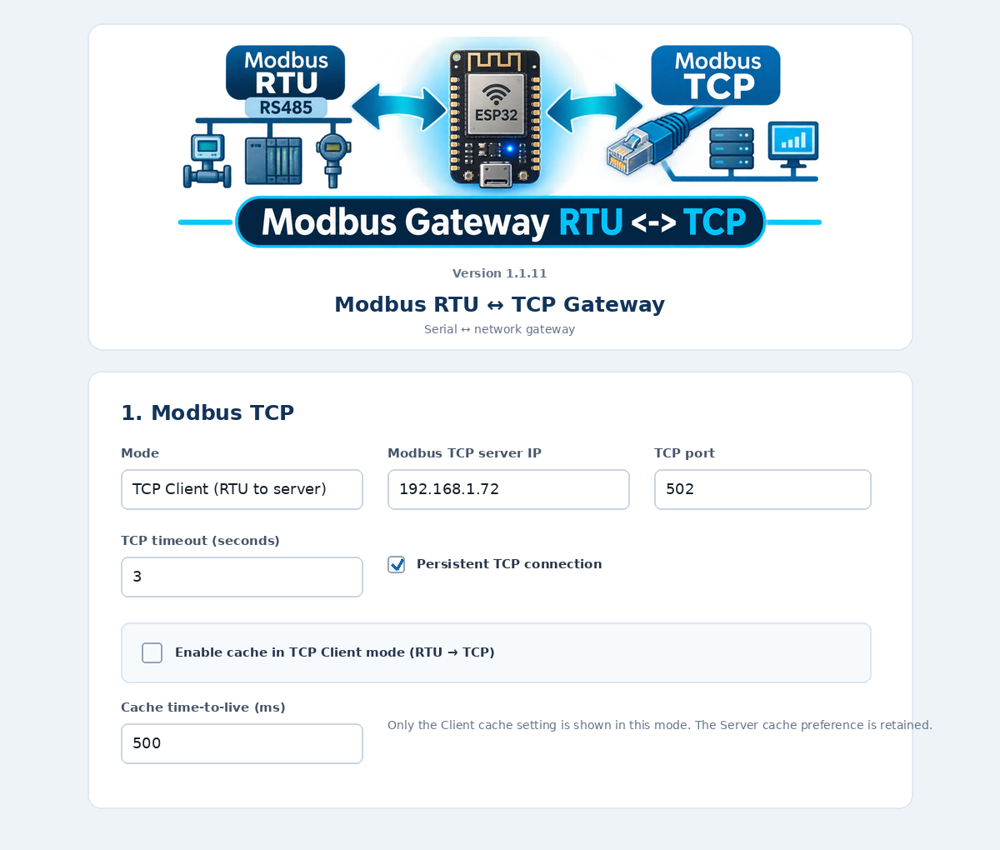
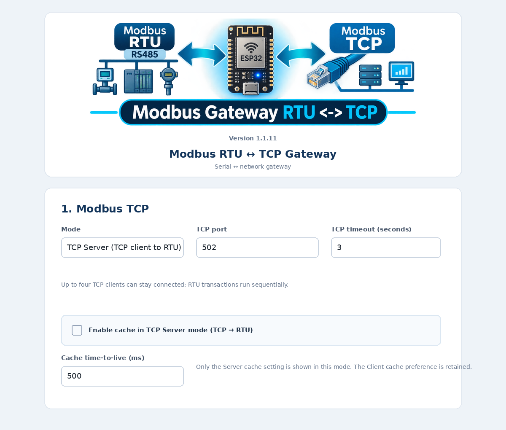

# Modbus response cache

The gateway includes an optional response cache for each operating mode. The cache is intended to reduce repeated polling latency when a master asks for the same read data more than once within a short interval.

## Independent mode switches

The Web UI exposes two independent settings in **1. Modbus TCP**. To keep the page unambiguous, it displays only the setting that belongs to the currently selected TCP mode:

- **TCP Client selected:** the UI shows **Enable cache in TCP Client mode (RTU → TCP)**, which reuses a previously received Modbus TCP read response for a matching RTU request.
- **TCP Server selected:** the UI shows **Enable cache in TCP Server mode (TCP → RTU)**, which reuses a previously received RTU read response for a matching TCP request.

Both settings are independent and disabled by default. Changing the selected TCP mode updates the visible switch immediately without reloading the page. Saving in one mode updates only that mode’s cache setting; the hidden mode’s setting is preserved in NVS and appears again when that mode is selected.

## Web UI examples

Only the cache option for the current mode is displayed. Switching the mode selector changes the visible cache control immediately; it does not clear the hidden mode's setting.

### TCP Client mode

### TCP Server mode

These are documentation UI previews. Example addresses and values are illustrative.

## Time-to-live and capacity

A shared TTL setting applies to both directions. It can be set from **50 to 10,000 ms**; the default is **500 ms**. The cache holds up to **64 entries**. A cache hit does not refresh the stored timestamp, so frequently repeated reads cannot keep old data alive indefinitely. Entries expire relative to the time the response was actually fetched from the remote device.

The cache is stored in RAM only. It is cleared when the ESP32 restarts or when configuration is saved. Cache contents are not written to flash/NVS.

## Cache key

A cache entry is matched using:

- Communication direction (Client or Server mode)
- Effective RTU Unit ID
- Modbus function code
- Starting register/coil address
- Requested quantity

In Server mode, when manual RTU ID is selected, the effective configured RTU Unit ID is used as the device key. The TCP response still carries the Unit ID from the current TCP request, and the current client's Transaction ID is always used.

## What is cached

Only valid, structurally correct read responses for standard function codes are stored:

- `01` – Read Coils
- `02` – Read Discrete Inputs
- `03` – Read Holding Registers
- `04` – Read Input Registers

The response function code and byte count are checked before a response is stored. Modbus exception responses and malformed responses are not cached.

Write operations and read/write operations are never cached. After a successful non-read operation, cached entries for the affected RTU Unit ID are invalidated. This includes standard write functions such as `05`, `06`, `0F`, `10`, `16`, and `17`; other non-read functions are also treated conservatively as possible data changes.

## Diagnostics

The frame diagnostics and `.txt` export show cache events:

- `CACHE MISS` – no valid matching entry was found; the request is sent to the remote device.
- `CACHE STORE` – a valid read response was stored.
- `CACHE HIT` – a matching, unexpired response was reused.
- `CACHE INVALIDATE` – a successful non-read operation removed entries for that Unit ID.

On a cache hit, Client mode sends the cached PDU back over RTU. Server mode creates a fresh TCP MBAP header using the current request's Transaction ID and TCP Unit ID, and does not transmit anything on RS-485 for that request.

## Data freshness warning

A cache hit intentionally returns a previous valid device response. The data can be as old as the configured TTL. Choose a TTL appropriate for the process and its update rate. If stale data is unsafe or unacceptable, leave the corresponding mode's cache disabled. The cache is a performance option, not a substitute for device-side update timing or application-level freshness checks.

## Interaction with asynchronous Client TCP processing

From component release 1.1.9, normal RTU-originated Client TCP transactions receive the remote TCP response cooperatively through the ESPHome loop. Cache hits remain immediate and do not open or use the TCP socket. A manual transaction initiated from the Web UI still uses the synchronous diagnostic helper; it is refused with HTTP 409 while a normal Client TCP transaction is already in progress so that both operations cannot read from the same TCP stream concurrently.
