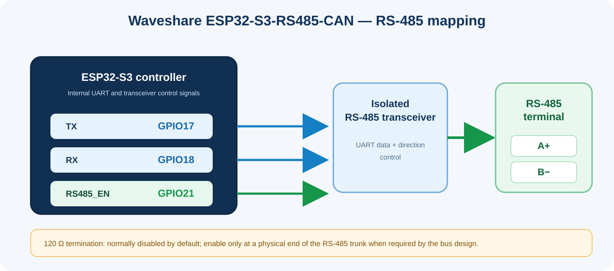

<!-- SPDX-License-Identifier: GPL-3.0-or-later -->
<!-- Copyright (C) 2026 Modbus RTU-TCP Gateway contributors. -->

# Hardware: Waveshare ESP32-S3-RS485-CAN

## Reference board

The project is currently tested by its maintainer with the **Waveshare ESP32-S3-RS485-CAN** board. Waveshare also sells an ESP32-S3-RS485-CAN-U variant with an external antenna connector; confirm your exact board variant and its antenna arrangement before installation.

Official references:

- [Waveshare ESP32-S3-RS485-CAN product documentation](https://docs.waveshare.com/ESP32-S3-RS485-CAN)
- [Waveshare resources and schematic](https://docs.waveshare.com/ESP32-S3-RS485-CAN/Resources-And-Documents)
- [Board schematic PDF](https://files.waveshare.com/wiki/ESP32-S3-RS485-CAN/ESP32-S3-RS485-CAN-Schematic.pdf)
- [Waveshare FAQ](https://docs.waveshare.com/ESP32-S3-RS485-CAN/FAQ)

The board documentation describes an ESP32-S3 controller, 2.4 GHz Wi-Fi/Bluetooth LE, an isolated RS-485 interface, USB Type-C and a screw-terminal supply input. The board's power screw terminal accepts 7–36 V DC; USB Type-C is specified for 5 V. Check the current vendor documentation for the exact board revision and power requirements.

## RS-485 signal mapping used by this project

| Signal | GPIO | Function |
|---|---:|---|
| TXD1 | GPIO17 | UART transmit to the RS-485 transceiver |
| RXD1 | GPIO18 | UART receive from the RS-485 transceiver |
| RS485_EN | GPIO21 | RS-485 transmit/receive direction control |

These are the project's default values and correspond to the Waveshare reference-board schematic. The initial configuration in the component sets TX=17, RX=18 and DE/RE/EN=21. They can be changed in the web UI for other hardware, but do not change them on this Waveshare board unless you are deliberately adapting the mapping.

## RS-485 terminal wiring

- Connect the bus **A / D+** conductor to the board's **A+** terminal.
- Connect the bus **B / D−** conductor to the board's **B−** terminal.
- Keep the bus as a daisy-chain/trunk where possible; avoid long star branches.
- Verify the A/B naming convention of every connected vendor. A/B labels are not always used consistently across manufacturers; if communication fails, check each device's documentation before swapping the pair.
- The Waveshare board's RS-485 transceiver is isolated. Do not defeat the isolation by casually bonding the isolated bus side to logic ground; follow the grounding and EMC design of the installation.

## Termination

Waveshare documents a reserved **120 Ω** matching resistor on the RS-485 interface. It is normally **not connected (NC)** and can be enabled with a jumper cap.

Use termination only at the physical ends of the RS-485 trunk, according to the bus topology and the other devices' built-in termination. Do not enable the resistor on every node. Biasing and termination should be considered as a complete bus design, not as a software setting.

## Power and installation notes

- The product documentation specifies USB Type-C 5 V input and a separate screw-terminal input range of 7–36 V DC. Use the appropriate input for your installation and verify polarity.
- The board is housed in a DIN-rail style enclosure and includes isolated RS-485 and CAN interfaces. This gateway uses the RS-485 interface only; CAN is not used by the firmware.
- The on-board RS-485 transmit/receive LEDs can help confirm bus activity. Use the frame diagnostics page as an additional software-level indicator.
- Confirm the antenna variant and Wi-Fi signal level at the installation location. The board's wireless link is 2.4 GHz Wi-Fi.

## Important

The GPIO assignment and RS-485 direction behaviour are board-specific. This documentation describes the Waveshare reference board, not every ESP32-S3 carrier board. Always check the schematic and board revision before using the default GPIOs on other hardware.
