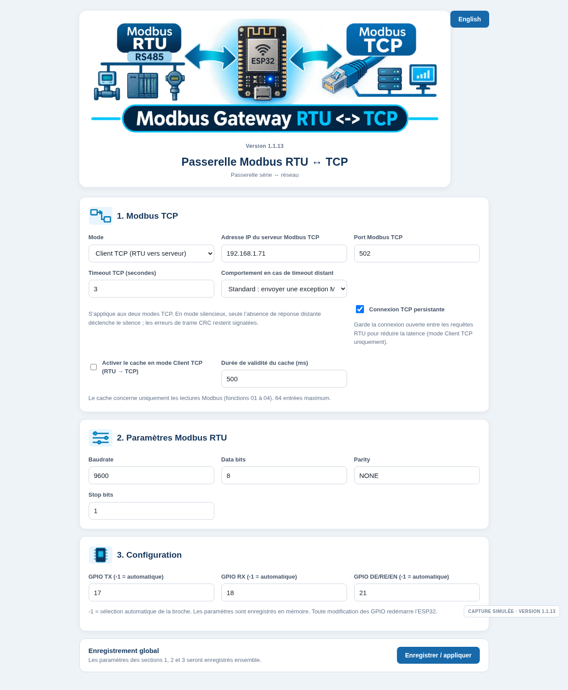
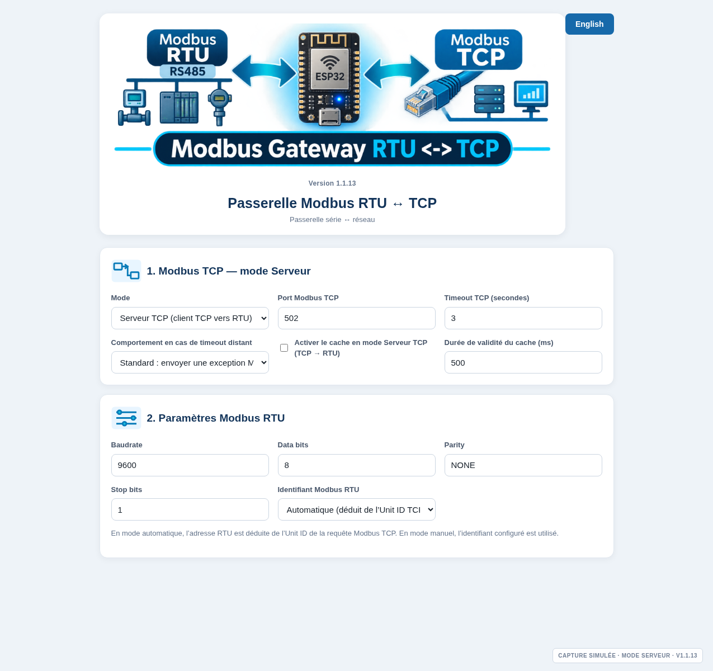
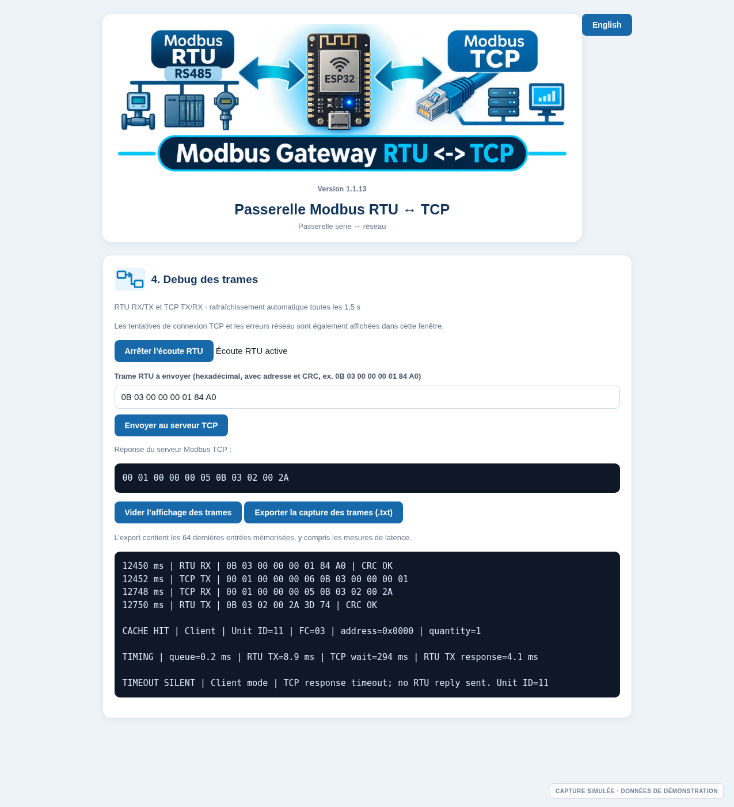

<!-- SPDX-License-Identifier: GPL-3.0-or-later -->
<!-- Copyright (C) 2026 Modbus RTU-TCP Gateway contributors. -->

# Quick start and configuration

## 1. Requirements

- ESPHome with ESP32 support installed on a computer, or ESPHome Dashboard.
- An ESP32-S3 board with an RS-485 transceiver. The tested reference board for this project is Waveshare ESP32-S3-RS485-CAN.
- A 2.4 GHz Wi-Fi network reachable by the ESP32 and the Modbus TCP endpoint.
- A Modbus RTU device and a correctly wired RS-485 bus for end-to-end testing.

## 2. Prepare the ESPHome configuration

The repository contains:

- `my-modbus-gateway.yaml` — ESPHome node, Wi-Fi, API, OTA and component configuration.
- `components/modbus_gateway/` — the local custom ESPHome component.

Create `secrets.yaml` in the same directory as the YAML file. Use `secrets.yaml.example` as a template and replace every placeholder. Keep the real file out of Git.

The YAML also defines a fallback access point named `Modbus-Gateway-Setup` with the example password `modbus1234`. This is only a recovery path; change that password before deployment and use a trusted Wi-Fi network for normal operation.

The supplied YAML uses:

```yaml
esp32:
  board: esp32-s3-devkitc1-n16r8
  framework:
    type: arduino
```

The component uses Arduino `WiFi`, `WebServer` and `Preferences` libraries. Do not change the framework to ESP-IDF unless the component is ported and tested for it.

## 3. Compile and flash

```bash
esphome compile my-modbus-gateway.yaml
esphome upload my-modbus-gateway.yaml
```

The first upload can be performed over USB. Subsequent OTA updates are available when the node is connected to Wi-Fi and the ESPHome OTA configuration is reachable.

If the board does not enter download mode, follow the board manufacturer's BOOT/RESET procedure in the [Waveshare documentation](https://docs.waveshare.com/ESP32-S3-RS485-CAN/FAQ).

## 4. Open the web interface

After the node joins Wi-Fi, find its IP address in ESPHome logs or the DHCP client list. Open:

```text
http://<ESP32-IP>/
```

The web UI listens on TCP port **80**. The Modbus TCP listener/client port is a separate setting (502 by default).

The TCP endpoint and RTU serial parameters are intentionally **not hard-coded in the YAML**. The component supplies first-boot defaults: TCP Client mode, remote host `192.168.1.100`, TCP port `502`, and RTU `9600 8N1`. These values can be changed in the web interface. Press **Save / apply** to store them in ESP32 non-volatile storage (NVS); saved values are loaded at every subsequent boot and take precedence over the component defaults.

## 5. Configure Section 1 — Modbus TCP

Select one operating mode:

### TCP Client (RTU to TCP server)

- The ESP32 receives RTU requests from the RS-485 bus.
- It forwards each request to the configured remote Modbus TCP server.
- Enter the remote server IP address and TCP port.
- The RTU slave address is retained as the TCP Unit ID.
- The RTU ID override controls are hidden in this mode.
- **Persistent TCP connection** is enabled by default. The gateway keeps the socket open between RTU requests to reduce latency and reconnects after a detected disconnect. Disable this option only if the remote server requires a new connection for every request.

### TCP Server (TCP masters to RTU)

- The ESP32 listens for inbound Modbus TCP connections on its configured port.
- Up to four TCP masters can stay connected concurrently.
- The remote host field is hidden because the ESP32 is the TCP server.
- The RTU ID selector is visible; choose Automatic or Manual.

The TCP timeout is configurable from 1 to 30 seconds; the initial value is 3 seconds.

### Remote timeout response policy

The **Remote timeout behavior** selector is shared by both modes and defaults to **Standard**.

- **Standard:** if the remote TCP server (Client mode) or downstream RTU slave (Server mode) does not provide a complete response before the configured timeout, the gateway returns exception `0x0B` to the upstream master/client.
- **Silent:** for that remote-response timeout only, the gateway sends no RTU response in Client mode or no TCP response in Server mode. The upstream master/client then applies its own timeout. The TCP session in Server mode remains available for later requests.

The setting is saved across restarts. It does not suppress CRC errors or other transport/protocol failures. In Client mode, for example, connection/protocol failures continue to use exception `0x0A`; a corrupt RTU request is discarded. In Server mode, an invalid RTU response is still rejected and reported with exception `0x0B`. See [Protocol behaviour](PROTOCOL.md#remote-timeout-policy-v113) for exact details.

### Response cache (mode-specific)

The cache control follows the selected mode: **TCP Client** shows only the Client cache switch, while **TCP Server** shows only the Server cache switch. Switching modes changes the visible option immediately. The two settings are independent: saving one mode does not overwrite the other mode's hidden setting. The shared TTL is configurable from 50 to 10,000 ms (default 500 ms). Both caches are disabled by default. See [Cache behavior and configuration](CACHE.md) before enabling caching on a process where stale values could be unsafe.


### Interface Web — aperçu illustratif

Les images ci-dessous sont des simulations de la mise en page de la version 1.1.13. Les valeurs et les trames affichées sont des exemples, pas des captures d’une passerelle connectée.







## 6. Configure Section 2 — Modbus RTU

Set the serial parameters to match the RTU devices on the RS-485 segment:

- Baud rate: 1200, 2400, 4800, 9600, 19200, 38400, 57600 or 115200.
- Data bits: 7 or 8.
- Parity: None, Even or Odd.
- Stop bits: 1 or 2.

The initial serial format is **9600, 8 data bits, no parity, 1 stop bit (9600 8N1)**.

In TCP Server mode, select:

- **Automatic:** use the TCP request's Unit ID as the RTU address.
- **Manual:** use the configured RTU ID (1–247) for the RTU request, regardless of the Unit ID in the inbound TCP request. The TCP response retains the request's original Unit ID.

## 7. Configure Section 3 — GPIO

For the Waveshare ESP32-S3-RS485-CAN reference board, the project defaults are:

| Signal | GPIO |
|---|---:|
| UART TX | 17 |
| UART RX | 18 |
| RS-485 direction enable | 21 |

`-1` selects the component's automatic/default pin handling for that field. Use the exact pinout of your target board before changing GPIO values. Applying a GPIO change restarts the ESP32 so the UART and direction control can be initialized again.

## 8. Save all settings

The **Save / apply** button below Sections 1–3 saves all network, RTU, TCP persistence and GPIO settings together. Settings are stored persistently in ESP32 NVS using Arduino Preferences and are loaded again at boot.

The **Restart gateway** button reboots the ESP32 without changing saved settings. It uses a five-second countdown page and automatically returns to the main Web UI when the gateway responds again. If a GPIO value changed, saving the configuration also triggers this restart flow automatically.

## 9. Use Section 4 — Frame diagnostics

The diagnostics page provides:

- RTU listening pause/resume control in TCP Client mode.
- A manually entered RTU frame test (hexadecimal bytes including RTU address and CRC).
- A display of the response to the manual test.
- A live rolling log of RTU RX/TX and TCP RX/TX events.
- `TIMING` entries with per-stage durations in microseconds. In TCP Client mode these report connection/reuse, TCP write, TCP response wait and end-to-end RTU response transmission. In TCP Server mode they report client queue wait, RS-485 transmit time, RTU response wait, TCP response write and total gateway processing time.
- RTU CRC validation indicators in the browser.
- **Export frame capture (.txt)**, which downloads `modbus-frame-capture.txt` with up to the 64 most recent logged entries, including timing diagnostics.

Frame timestamps are milliseconds since ESP32 boot; they are not wall-clock timestamps.

## 10. Verify the installation

1. Confirm the ESP32 is connected to Wi-Fi.
2. Open the web page and verify the saved mode and serial settings.
3. Confirm that the RS-485 bus A+/B− wiring and termination are correct.
4. Test one known RTU slave before connecting multiple TCP masters.
5. In TCP Server mode, connect up to four independent Modbus TCP clients and check that each receives its own response.
6. Review the frame log and export it if you need a troubleshooting record.

## 11. CRC and latency diagnostics

Invalid RTU CRC frames are discarded before forwarding or cache storage. The Web trace reports `CRC ERROR` with the received and calculated CRC. In TCP Server mode, an invalid RTU response is not forwarded as data; the TCP requester receives gateway exception `0x0B`. Incomplete RTU responses and timeouts are logged as `RTU ERROR`. If Silent timeout behavior is selected, the log also records `TIMEOUT SILENT` and no upstream response is sent.

The diagnostics also report per-stage timing and receive-byte observations. These are software timestamps from the ESP32, not oscilloscope measurements. See [Latency diagnostics](LATENCY_DIAGNOSTICS.md).
